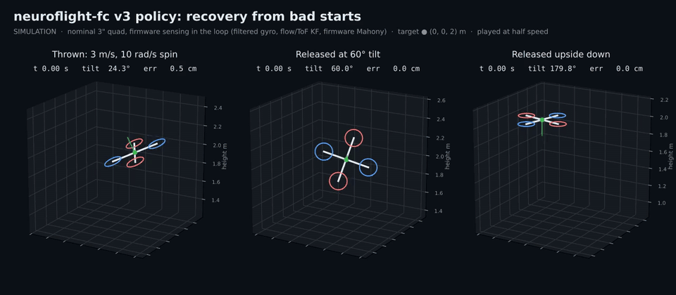
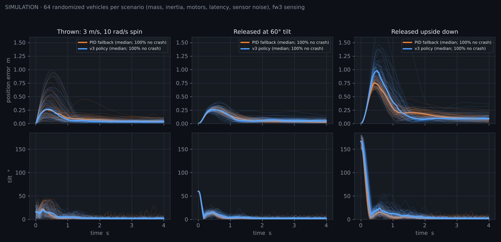

# neuroflight-fc

A custom flight controller that flies a 3" quadcopter with a **sim-trained neural control policy**,
backed by a classical cascaded-PID fallback and a **Simplex safety supervisor**. The policy is trained
with PPO in a batched GPU-free simulator that runs the firmware's own estimators in the loop, then
runs unchanged (float or int8) inside a C++17 firmware core that is also flown software-in-the-loop.
Plan: [docs/PLAN.md](docs/PLAN.md) · interfaces: [docs/INTERFACES.md](docs/INTERFACES.md) ·
status: [docs/STATUS.md](docs/STATUS.md).



<sub>**Simulation.** `hover_ctbr_v3` on the nominal vehicle from the eval suite's initial states, firmware
sensing in the loop, drawn at half speed. Full clip: [recovery-reel.mp4](docs/media/recovery-reel.mp4).
Regenerate: `python -m tools.recovery_reel`.</sub>



<sub>Same scenarios on 64 randomized vehicles each (mass, inertia, motor constants, latency, sensor noise):
thin lines are individual vehicles, thick lines the median. The eval suite's stricter success metric
(position error under 10 cm over the last 0.5 s) is in [train/policies/hover_ctbr_v3.md](train/policies/hover_ctbr_v3.md).</sub>

## Results (all without hardware)

| Piece | Result |
|---|---|
| Simulator (`sim/`) | Batched quad sim, about 600k steps/s on 4 CPU cores. The PID baseline recovers from a 60° tilt on 100 % of randomized vehicles |
| Firmware core (`fw/core`) | C++17 with no heap or exceptions: filters, Mahony with a KF-acceleration reference, rate PID and mixer, cascaded fallback, float and int8 MLP, Simplex supervisor with a fallback ladder, gyro calibration |
| int8 toolchain (`tools/`) | quantize, golden model, codegen. The C++ int8 output matches Python bit for bit on 12k vectors |
| Policy v3 (`train/policies`) | Trained against the ported firmware Mahony estimate with monitor margins and smoothness losses (62 min on 4 cores). Training env, randomized: hover 98.8 %, throw 97.9 %, tilt 86.5 % |
| SITL (`fw/sitl`) | The real firmware flying v3 on 20 randomized vehicles: hover 2.8 cm median with no trips, tilt recovery 19/20, push recovery 20/20 |
| Safety | 8 injected faults (NaN, saturation, oscillation, flip, IMU disagreement, RC loss, deadline overrun, kill) are all handled. A flip is caught at about 27° tilt |
| Board (`hw/`) | Pin map with checker, BOM about $65 per board in a run of 5, order list |

Key finding: v1 looked perfect in training but flew poorly in the real firmware, because the firmware's
flow-based velocity estimate has correlated error that training never saw. Putting the firmware's own
estimator and gyro filtering into the training sim fixed hover (8.5 → 3.4 cm median, 2 trips → 0). v3 then
ported the firmware Mahony into the sim and changed its accelerometer reference, which removed the
remaining estimator trips. Open items: [docs/FOLLOWUPS.md](docs/FOLLOWUPS.md).

## Layout

| Dir | Contents |
|---|---|
| `sim/` | batched quadrotor dynamics, CTBR env, firmware estimator ports, PID baseline |
| `train/` | PPO, eval suite, policy export, trained policies (`hover_ctbr_v1..v3`) |
| `tools/` | int8 quantizer, golden model, C++ codegen, param and test-vector generators, media scripts |
| `fw/core`, `fw/sitl` | firmware core library and its software-in-the-loop harness |
| `hw/` | board design notes, pin map + checker, BOM, order list |
| `test/` | pytest suites for sim, train, tools and SITL |

## Verify

```bash
pip install numpy torch pyyaml pytest matplotlib
pytest -q test                                                     # 163 passed + 2 expected failures
cmake -S fw/core -B build/core && cmake --build build/core && ctest --test-dir build/core
python -m train.eval train/policies/hover_ctbr_v3.nfpol.json --sensing fw3
python -m tools.recovery_reel                                      # docs/media/*
```

The flight-validated airframe that pairs with this controller is in
[drone-design](https://github.com/Ashtonantony28/drone-design).
